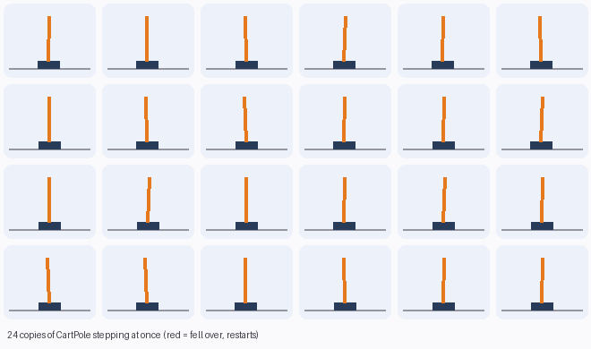
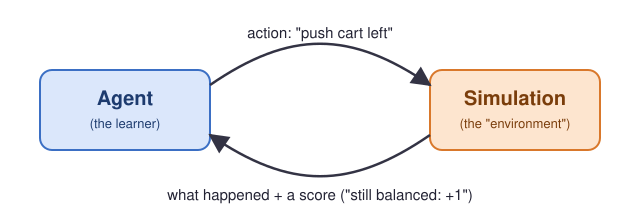
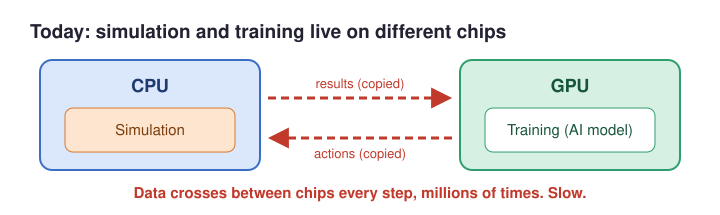
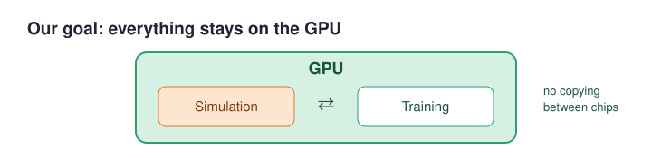

# CudaGymGL
**Running thousands of training simulations in parallel, on a GPU.**

Many copies of one simulation running side by side.

## 1. Background: how AI learns by trial and error
In **reinforcement learning (RL)**, an AI "agent" learns a task by trying actions in a simulation and getting a score back. Example: balance a pole on a moving cart (**CartPole**, shown above).

The agent needs **millions** of these tries to learn. So the speed of the simulation matters a lot.

## 2. The problem: data keeps crossing between CPU and GPU
The AI model usually trains on the **GPU**, but popular RL simulations (like the ones in the **Gymnasium** library) run on the **CPU**. So every step, data must be copied back and forth: simulation results go to the GPU, and the model's actions come back to the CPU. Each copy is slow, and it happens millions of times.

## 3. Our approach: put the simulation on the GPU too

- **Write the sim in CUDA:** Now both simulation and training run on the GPU.
- **Run thousands of copies in parallel:** Each GPU thread runs one copy of the simulation.
- **Retain modularity:** Wrap the code similar to a normal Gymnasium environment.
- **Visualize the environment:** An OpenGL window renders the sim in real time (like the GIF above).

Simulations: CartPole and Acrobot (a swinging two-link arm). Stretch goal: balls bouncing in a box.

## 4. Expected results
- **Speed:** steps per second as the number of copies grows from 1 to 1 million. Compare the normal CPU version against our all-GPU version. We expect the GPU to pull far ahead **ONLY** at large counts. This is because these Gymnasium toy environments are actually very simple for the CPU to produce millions of parallel copies. Herein, GPU parallelization should not truly accelerate learning much.
- **Copying cost:** measure how much time CPU-to-GPU copying takes per step, and how much we save by removing it.
- **Correctness:** GPU results match the original Gymnasium simulation step for step.
- **Demo:** a live window showing many simulations at once.